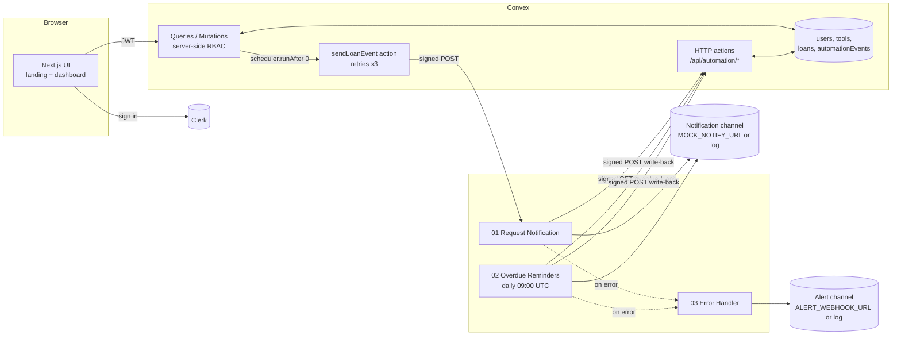

# LendLoop

**Borrow what you need. Lend what you don't.**

LendLoop is a neighborhood tool-lending app. Neighbors list tools, request to borrow them for a date range, and owners approve, decline, or mark loans returned. Every loan event goes to a self-hosted **n8n** instance over an HMAC-signed webhook. n8n sends a notification and writes the result back to Convex. A daily n8n job finds overdue loans, sends reminders, and writes those results back too. Write-backs are idempotent, and failures raise alerts.

| Layer | Technology |
| --- | --- |
| Web app | Next.js 16 (App Router), TypeScript, Tailwind CSS v4 |
| Auth | Clerk (`@clerk/nextjs`) |
| Database and backend logic | Convex (queries, mutations, actions, HTTP actions) |
| Automation | n8n 2.48.6 (self-hosted with Docker Compose) |
| Tests | Vitest + `convex-test` (in-memory Convex backend) |

## Architecture



### Wire contract (both directions)

| Item | Value |
| --- | --- |
| Algorithm | `hex(HMAC_SHA256(N8N_WEBHOOK_SECRET, "${timestamp}.${rawBody}"))` |
| Headers | `X-LendLoop-Timestamp` (Unix seconds), `X-LendLoop-Signature` (lowercase hex) |
| GET requests | `rawBody` is the empty string |
| Freshness | Requests are rejected when the timestamp is more than 5 minutes from server time, in either direction |
| Comparison | Constant-time (XOR accumulate in Convex, `crypto.timingSafeEqual` in n8n) |
| Outgoing payload (Convex to n8n) | `eventId, eventType, loanId, toolName, status, startDate, endDate, recipientDisplayName` |
| Idempotency keys | `notif:${eventId}` for notifications, `overdue:${loanId}:${YYYY-MM-DD}` for reminders |

| Endpoint | Caller | Purpose |
| --- | --- | --- |
| `POST {N8N}/webhook/lendloop-request` | Convex action | A loan was requested, approved, declined, or returned |
| `GET {CONVEX_SITE}/api/automation/overdue-loans` | n8n 02 | Approved loans past `endDate` (UTC) that have no reminder today. Minimal fields only. |
| `POST {CONVEX_SITE}/api/automation/reminder-status` | n8n 01 and 02 | Idempotent write-back. A repeated key returns `200 {"deduplicated": true}`. |

The contract is implemented in one file, [`convex/lib/hmac.ts`](convex/lib/hmac.ts). The n8n Code nodes use the same algorithm, and a test checks that both sides produce the same bytes.

## Project structure

```
convex/
  schema.ts            users, tools, loans, automationEvents (+ indexes)
  lib/auth.ts          caller from ctx.auth (Clerk JWT) only; requireUser / requireAdmin
  lib/policy.ts        pure RBAC + validation rules (used by functions AND tests)
  lib/hmac.ts          HMAC-SHA256 sign/verify (Web Crypto), the wire contract
  users.ts             store (user sync + admin bootstrap), me
  tools.ts             listPublicAvailableTools, listBrowseTools, CRUD
  loans.ts             requestLoan, updateLoanStatus, listMyRequests, listIncomingRequests
  admin.ts             listAllLoans, listLenders, setTrustedLender
  automation.ts        sendLoanEvent (outgoing), recordAutomationEvent, listOverdueLoans
  http.ts              /api/automation/overdue-loans, /api/automation/reminder-status
  auth.config.ts       Clerk issuer for Convex
src/
  proxy.ts             Clerk middleware (Next 16 name), protects /dashboard
  app/page.tsx         public landing page
  app/dashboard/       Browse, My Listings, My Requests, Incoming, Admin tabs
n8n/workflows/         01-request-notification, 02-overdue-reminders, 03-error-handler
tests/                 hmac, rbac, idempotency, workflows (Vitest)
docker-compose.yml     n8n with a persistent volume, env passthrough, and a healthcheck
```

## Local setup

Prerequisites: Node.js 22.12 or newer (tested on 24; Convex and Vitest need 22+), Docker Desktop, and a free Clerk account. A Convex account is optional.

### 1. Install and create the shared secret

```bash
git clone https://github.com/jam3h-dev/lendloop.git
cd lendloop
npm install
cp .env.example .env
```

Generate the HMAC secret now, before you configure Convex:

```bash
openssl rand -hex 32
```

Put the output in `.env` as `N8N_WEBHOOK_SECRET`. Step 3 copies this same value to Convex. If the two values differ, every signature check fails.

### 2. Clerk

1. Create an application in the [Clerk dashboard](https://dashboard.clerk.com).
2. Copy the **Publishable key** to `NEXT_PUBLIC_CLERK_PUBLISHABLE_KEY` and the **Secret key** to `CLERK_SECRET_KEY` in `.env`.
3. Open https://dashboard.clerk.com/apps/setup/convex and select **Activate Convex integration**. Clerk session tokens then carry `aud: "convex"`, and `ConvexProviderWithClerk` sends them to Convex. Copy the **Frontend API URL**, for example `https://your-app.clerk.accounts.dev`. You need it in step 3.
4. Add name claims to the session token. Clerk's default session token has no name fields, so without this step every user shows as "Neighbor". In the Clerk Dashboard, go to **Sessions > Customize session token** and add these claims:

   ```json
   {
     "given_name": "{{user.first_name}}",
     "family_name": "{{user.last_name}}",
     "nickname": "{{user.username}}"
   }
   ```

   Convex maps these claims to `identity.givenName`, `identity.familyName` and `identity.nickname`. LendLoop stores only a short form such as "Ava K.". It never stores the full name or the email.

### 3. Convex

Pick one mode.

**Mode A: local Convex backend (recommended for a review).** n8n and Convex can reach each other without a tunnel.

```bash
npx convex dev
```

When the CLI asks, choose **"Start without an account (run Convex locally)"**. If you are logged in, choose a local deployment. The backend runs on `http://127.0.0.1:3210`, and its HTTP actions run on `http://127.0.0.1:3211`.

The first push fails with `Environment variable CLERK_JWT_ISSUER_DOMAIN is used in auth config file but its value was not set`. This is expected. Keep the terminal open, run the commands below in a second terminal, then stop `npx convex dev` (Ctrl+C) and start it again.

```bash
npx convex env set CLERK_JWT_ISSUER_DOMAIN https://your-app.clerk.accounts.dev
npx convex env set N8N_WEBHOOK_SECRET <the value from .env>
npx convex env set N8N_REQUEST_WEBHOOK_URL http://localhost:5678/webhook/lendloop-request
```

In `.env`, set `CONVEX_HTTP_BASE_URL=http://host.docker.internal:3211`.

**Mode B: Convex cloud.** Run `npx convex dev` and log in. A cloud deployment cannot reach `localhost:5678`, so expose n8n through a tunnel, for example `cloudflared tunnel --url http://localhost:5678` or `ngrok http 5678`. Then:

```bash
npx convex env set CLERK_JWT_ISSUER_DOMAIN https://your-app.clerk.accounts.dev
npx convex env set N8N_WEBHOOK_SECRET <the value from .env>
npx convex env set N8N_REQUEST_WEBHOOK_URL https://<your-tunnel>/webhook/lendloop-request
```

In `.env`, set `CONVEX_HTTP_BASE_URL=https://<deployment>.convex.site` (the `.site` host, not `.cloud`) and `N8N_PUBLIC_URL=https://<your-tunnel>/`.

### 4. Run the web app

```bash
npm run dev
```

Open http://localhost:3000 and sign in. To make yourself an admin, copy your user ID (`user_...`) from the Clerk dashboard. Then run the command below and reload `/dashboard`. The role is recomputed on every sign-in sync.

```bash
npx convex env set ADMIN_CLERK_IDS user_xxx
```

### 5. n8n

Make sure `.env` holds the same `N8N_WEBHOOK_SECRET` that you set on Convex in step 3. Start n8n and import the three workflows. Import order does not matter because the workflow IDs are fixed.

```bash
docker compose up -d
docker compose exec n8n n8n import:workflow --separate --input=/workflows
```

Publish (activate) the workflows, then restart n8n:

```bash
docker compose exec n8n n8n publish:workflow --id=lendloopErrorWf1
docker compose exec n8n n8n publish:workflow --id=lendloopRequest1
docker compose exec n8n n8n publish:workflow --id=lendloopOverdue1
docker compose restart n8n
```

On Windows Git Bash, put `MSYS_NO_PATHCONV=1` in front of the `exec` commands. Otherwise Git Bash rewrites `/workflows` into a Windows path.

- To see the editor, open http://localhost:5678 and create the local owner account.
- `01` and `02` reference `lendloopErrorWf1` in **Settings > Error workflow**. If you import through the UI instead of the CLI, n8n can assign new IDs. If that happens, select "LendLoop 03 - Error Handler" again in the settings of 01 and 02.
- If `MOCK_NOTIFY_URL` and `ALERT_WEBHOOK_URL` are empty, notifications and alerts go to the n8n log. To read them, run `docker compose logs -f n8n`.
- To run the overdue job now instead of waiting for 09:00 UTC, open workflow 02 and click **Execute workflow**. You can also use the CLI. The extra broker port avoids a clash with the running instance.

```bash
docker compose exec -e N8N_RUNNERS_BROKER_PORT=5690 n8n n8n execute --id=lendloopOverdue1
```

### 6. Tests

```bash
npm test
npx tsc --noEmit
npm run lint
npm run build
```

`npm test` needs no credentials. It runs the real Convex functions on the `convex-test` in-memory backend, in the `edge-runtime` environment, which is the same kind of V8 runtime as Convex.

## Environment variables

| Variable | Where | Required | Purpose |
| --- | --- | --- | --- |
| `NEXT_PUBLIC_CONVEX_URL` | `.env` / `.env.local` (Next.js) | yes | Convex client URL. `npx convex dev` writes it. |
| `CONVEX_DEPLOYMENT` | `.env.local` | yes | Written by `npx convex dev` |
| `NEXT_PUBLIC_CLERK_PUBLISHABLE_KEY` | `.env` (Next.js) | yes | Clerk frontend key |
| `CLERK_SECRET_KEY` | `.env` (Next.js) | yes | Clerk server key, used by `src/proxy.ts` |
| `CLERK_JWT_ISSUER_DOMAIN` | Convex env | yes | Clerk Frontend API URL. Convex verifies JWTs against it. |
| `ADMIN_CLERK_IDS` | Convex env | no | Comma-separated Clerk user IDs that get the `admin` role |
| `N8N_WEBHOOK_SECRET` | Convex env **and** `.env` (n8n) | yes for automation | Shared HMAC-SHA256 secret, the same value on both sides |
| `N8N_REQUEST_WEBHOOK_URL` | Convex env | yes for automation | n8n webhook for loan events. If it is unset, Convex skips notifications. |
| `CONVEX_HTTP_BASE_URL` | `.env` (n8n) | yes | Convex HTTP actions base URL (`*.convex.site` or `http://host.docker.internal:3211`) |
| `MOCK_NOTIFY_URL` | `.env` (n8n) | no | Notification POST target. If it is empty, n8n logs the notification. |
| `ALERT_WEBHOOK_URL` | `.env` (n8n) | no | Failure alert POST target. If it is empty, n8n logs the alert. |
| `N8N_PUBLIC_URL` | `.env` (n8n) | no | Public n8n URL, for webhook URLs behind a tunnel |

The compose file also sets these n8n runtime flags:

- `N8N_BLOCK_ENV_ACCESS_IN_NODE=false`: lets workflows read `$env`.
- `NODE_FUNCTION_ALLOW_BUILTIN=crypto`: lets Code nodes use HMAC.
- `CODE_ENABLE_STDOUT=true`: sends Code-node logs to `docker compose logs`.
- Diagnostics are off.

## Security and data-minimization decisions

1. **Server-side RBAC in every Convex function.**
   - The caller comes only from `ctx.auth.getUserIdentity()`, which is the Clerk JWT that Convex verifies, mapped through `users.by_clerkId`.
   - No function accepts a `userId`, `ownerId`, or `role` from the client. `ownerId` comes from the caller on create, and from the tool on a loan request.
   - All rules live in one pure module, [`convex/lib/policy.ts`](convex/lib/policy.ts). The functions call it, and the tests test it.
   - A user can edit or delete only their own listings, and can approve, decline, or return only loans on their own tools. Admins can delete any listing, view all loans, and set `trustedLender`.
   - Loan status follows a strict state machine: `pending` to `approved` or `declined`, and `approved` to `returned`.
   - Approvals re-check for overlap with other approved loans inside the same serializable transaction. Two overlapping requests therefore cannot both be approved.
2. **Admin bootstrap from the environment only.** `ADMIN_CLERK_IDS` is read on the server during user sync. The role is recomputed on every sync, and no API can grant admin.
3. **Data minimization.**
   - `listPublicAvailableTools` projects to `{ _id, name, category }` at the query layer. Owner, description, and user data never leave the server for anonymous visitors. A test checks the exact keys.
   - LendLoop does not store emails or other Clerk profile data. It stores only a short display name ("Ava K.").
   - Outgoing webhooks carry only the 8 listed fields.
   - The overdue endpoint returns `loanId, toolName, endDate, daysOverdue, recipientDisplayName`.
   - n8n re-allow-lists the incoming payload fields before it uses them.
4. **HMAC-SHA256 with replay defense.**
   - Each side signs `${timestamp}.${rawBody}` and verifies the exact raw bytes. Convex calls `request.text()` once. The n8n Webhook node uses the **Raw Body** option.
   - Comparison is constant-time, and the timestamp window is ±5 minutes.
   - The server fails closed if the secret is missing. It returns a generic `401 {"error":"unauthorized"}` and does not say which check failed.
   - Bodies larger than 8 KB are rejected.
   - A signed write-back replayed inside the window is harmless because of idempotency. A replayed GET only reads minimal data.
5. **Idempotent write-backs.**
   - The key lookup, the insert, and the loan patch run in **one** Convex mutation, which is a serializable transaction. Concurrent retries with the same key therefore create one record. A test fires 5 retries in parallel.
   - A repeated key returns `200 {"deduplicated": true}` and never overwrites history.
   - Keys are bound to their event. `overdue:` keys must contain the body's `loanId` and a valid date, and `notif:` keys must be UUIDs.
   - `lastReminderAt` is set only by a delivered `overdue_reminder`, so a notification cannot suppress that day's reminder.
6. **Retries, and no silent failure.**
   - Every n8n call to Convex retries 3 times, 2 seconds apart.
   - The Convex outgoing webhook retries 3 times with exponential backoff and the same `eventId`, so n8n's `notif:` key stays idempotent. After the last attempt, Convex records a `failed` automation event, which the UI shows.
   - A failed notification send is written back as `failed` and does not stop the run.
   - Any workflow error (bad signature, write-back exhausted, and so on) triggers **03 Error Handler**. It produces a structured alert with workflow name, execution ID and URL, failing node, and error message. 64-character hex strings are scrubbed from the alert.
   - An unsigned or forged webhook gets `401` and also raises an alert.
7. **Secret isolation.**
   - Secrets live only in Convex deployment env vars, the n8n container environment, and the git-ignored `.env` / `.env.local` files. `.env.example` holds placeholders only.
   - The workflow JSON uses only `$env.N8N_WEBHOOK_SECRET` and `$env.CONVEX_HTTP_BASE_URL`. `tests/workflows.test.ts` fails if a hex secret, key, or deployment URL appears in the exports.

## What I would change for production

- **Hosting:**
  - Run Next.js on Vercel or AWS (Amplify, or ECS behind CloudFront).
  - Use a Convex production deployment.
  - Run n8n in queue mode with Postgres and Redis, on ECS or Kubernetes, with TLS and SSO. Pin the image by digest.
- **Secrets and key rotation:**
  - Keep secrets in AWS Secrets Manager or KMS, or in n8n's external-secrets or credentials store. With `$env` and `N8N_BLOCK_ENV_ACCESS_IN_NODE=false`, anyone who can edit workflows can read the container environment.
  - Rotate the HMAC secret with a key ID header and two valid secrets during the overlap.
  - Bind method and path into the signed string.
- **Rate limiting and WAF:**
  - Rate-limit the Convex HTTP actions and the mutations, per user and per IP (for example with the Convex rate-limiter component).
  - Put a WAF and bot protection in front of Next.js and n8n.
  - Restrict the n8n webhook to Convex egress where possible.
- **Immutable audit log:** keep an append-only audit table for role changes, trusted-lender toggles, deletions, and loan transitions. Export it to WORM storage, such as S3 Object Lock.
- **Dead-letter queue:** send webhooks that still fail after the retries to a DLQ (for example SQS) and replay them with a tool, instead of only recording `failed`.
- **Observability:** Sentry for the frontend and Convex errors. Datadog for metrics, traces, and alert routing (PagerDuty or Slack) in place of the log fallback. Alerts on signature failure spikes.
- **Encrypted backups:** scheduled Convex snapshot exports and n8n database backups, encrypted with KMS, with restore drills.
- **Other:**
  - Real notification channels with user opt-in.
  - Clerk webhooks to delete user data when an account is deleted.
  - Pagination on all lists.
  - Lender time zones for the "today" checks.
  - Per-attempt reminder keys. Today a failed reminder keeps that day's `overdue:` key, so a manual re-run on the same day is deduplicated and stays `failed`. The next day's run tries again.
  - CSP and security headers.
  - A CI pipeline that runs the full verification gate on every PR.

## Verification status

Results from 2026-11-19, on Windows 11, Node 24.19, Docker 29.8, and n8n 2.48.6.

| Check | Result | Notes |
| --- | --- | --- |
| `npx tsc --noEmit` | **PASS** | Root project, including `convex/` and `tests/`. `npx tsc --noEmit -p convex` also passes. |
| `npm run lint` | **PASS** | No warnings |
| `npm test` | **PASS** | 44 tests in 4 files: hmac, rbac, idempotency, workflows |
| `npm run build` | **PASS** | Run with format-valid placeholder `NEXT_PUBLIC_CLERK_PUBLISHABLE_KEY`, `CLERK_SECRET_KEY`, and `NEXT_PUBLIC_CONVEX_URL` passed inline. They are not stored in any file. |
| Workflow JSON valid + no secrets | **PASS** | Parsed with `JSON.parse`. A scan found no hex secrets, keys, or deployment URLs. The real local test secret appears in no tracked file. |
| `docker compose config` | **PASS** | |
| Clean checkout (`npm ci`, then `tsc`, `lint`, `test`, `build` in that order) | **PASS** | Only the files git would commit, so no `.env`, `.env.local`, `.next` or `next-env.d.ts` |
| Convex deploy (schema, indexes, functions, typecheck) | **PASS** | `npx convex dev --once --typecheck enable` against a local anonymous Convex backend |
| **Live end-to-end, Convex local backend + n8n in Docker** | **PASS** | Details below |
| UI in a browser, signed in through Clerk | **NOT TESTED** | Needs real Clerk keys. With a placeholder key, the Clerk middleware redirects to Clerk's handshake, as designed. |
| Clerk setup steps (integration + name claims) | **NOT TESTED** | Written from the current Clerk and Convex docs and the Convex `UserIdentity` claim mapping. The name fallback logic has a unit test. |
| Convex cloud deployment + tunnel (Mode B) | **NOT TESTED** | Needs a Convex account |

These live end-to-end checks ran against the local Convex backend and real n8n. Users were simulated with `npx convex run --identity`.

- A request created as the borrower made Convex send a signed webhook. n8n verified it against the raw body, logged the mock notification, and sent a signed write-back. Convex stored `request_notification / sent`. The same flow worked for an approval.
- A forged signature and a missing signature sent to the n8n webhook both got `401`. Workflow 03 then produced a structured alert (workflow, execution URL, failing node, message).
- With an approved loan past its end date, workflow 02 fetched it, logged the reminder, and wrote back `overdue:<loanId>:<date>`. Convex set `lastReminderAt`. A second run on the same day returned 0 loans.
- Direct probes of the Convex HTTP endpoints gave these results:
  - Bad signature: `401`.
  - Timestamp 6 minutes old: `401`.
  - Tampered body: `401`.
  - Replayed write-back: `200 {"deduplicated": true}`, and the event count did not change.
  - Key bound to another loan: `400`.
- With a wrong secret on the Convex side, n8n rejected all 3 attempts (with backoff). Convex then recorded `Notification failed after 3 attempts`, and n8n raised an alert for each rejection.
- With `MOCK_NOTIFY_URL` and `ALERT_WEBHOOK_URL` pointed at a local HTTP listener, the HTTP branches delivered the request notification, the overdue reminder, and the alert JSON. Convex recorded both events as `sent`.
- With `MOCK_NOTIFY_URL` pointed at a closed port, both workflows finished and wrote back `failed` (`Notification failed (requested)`, `Overdue reminder failed`). They did not crash.
- Workflow 02 with 3 overdue loans for different borrowers, on both the log branch and the HTTP branch: each loan got exactly one event, its own `overdue:<loanId>:<date>` key, the correct days-late count, and `lastReminderAt`. On the HTTP branch, each message went to the right borrower.
- The tests are not vacuous. Removing the dedup check failed 2 idempotency tests, and loosening `canDeleteTool` failed 2 RBAC tests. The code was restored afterwards.
